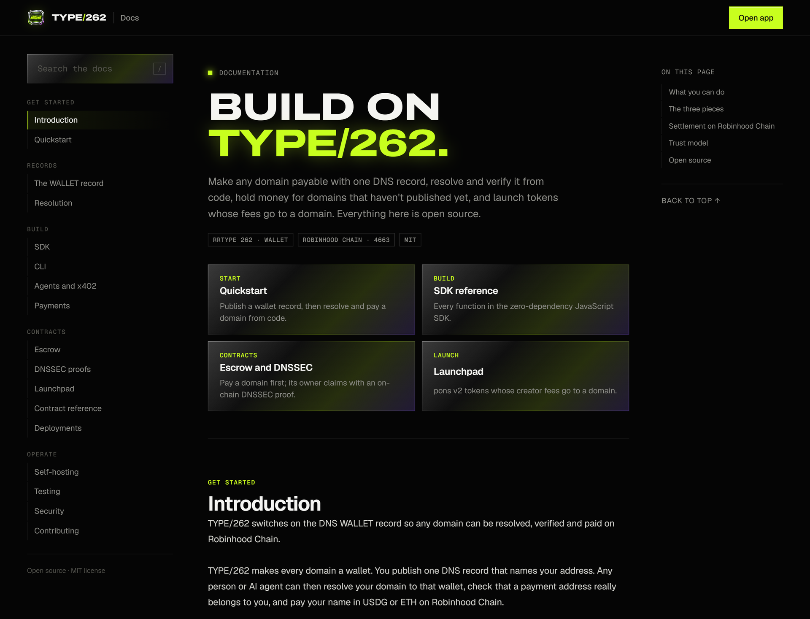

<div align="center">

<a href="https://type262.onrender.com"></a>

<h1>Every domain is a wallet.</h1>

<p>
DNS has had an official record type for crypto addresses since 2024: <b>RRTYPE&nbsp;262, <code>WALLET</code></b>.<br>
TYPE/262 switches it on. Publish one record, and any person or AI agent can <b>resolve</b> your domain to a wallet,<br>
<b>verify</b> that a payment address really belongs to you, and <b>pay</b> your name in USDG or ETH on Robinhood Chain.
</p>

<p>
<a href="https://github.com/Type262/262/actions/workflows/ci.yml"></a>
<a href="LICENSE"></a>
<a href="https://www.iana.org/assignments/dns-parameters/dns-parameters.xhtml#dns-parameters-4"></a>
<a href="https://robinhoodchain.blockscout.com"></a>
<a href="#deployments"></a>
<a href="#verify-an-x402-payto"></a>
<a href="https://x.com/type_262"></a>
</p>

<p>
<a href="https://type262.onrender.com"><b>Website</b></a>
&nbsp;·&nbsp;
<a href="https://type262.onrender.com/app.html"><b>Open the app</b></a>
&nbsp;·&nbsp;
<a href="https://type262.onrender.com/docs.html"><b>Docs</b></a>
&nbsp;·&nbsp;
<a href="https://type262.onrender.com/app.html#launch"><b>Launchpad</b></a>
&nbsp;·&nbsp;
<a href="#deployments"><b>Contracts</b></a>
&nbsp;·&nbsp;
<a href="https://x.com/type_262"><b>X</b></a>
</p>

</div>

<br>

## Why TYPE/262

HTTP status 402, *Payment Required*, was reserved "for future use" in 1997 and sat unused for decades, until x402 switched it on with stablecoins. DNS has a primitive in the same state. On 2024-06-21 IANA allocated **RRTYPE 262, `WALLET`**, a record type for crypto addresses, and almost nothing supports it yet.

TYPE/262 is the layer that makes it useful:

- **Site owners** add one DNS record and their domain becomes payable. No account, no checkout, no custody.
- **Wallets and apps** pay `yoursite.com` instead of `0x7a1f…c0de`, and DNSSEC tells them the answer is authentic.
- **AI agents** check that an x402 `payTo` address is published by the domain they are talking to before they pay it. One line of code, answered by DNS.
- **Anyone** can send money to any website today, even one that has never heard of TYPE/262. It waits on-chain until the owner proves the domain with DNSSEC.

<p align="center">
  
</p>

## What's inside

<table>
<tr>
<td width="50%" valign="top">

#### Resolve
Look up the wallets any domain publishes. Every lookup goes to Cloudflare and Google over DNS-over-HTTPS in parallel, flags any disagreement, and reports whether DNSSEC authenticated each record.

</td>
<td width="50%" valign="top">

#### Pay by name
Send USDG or ETH on Robinhood Chain to a domain's published wallet from any browser wallet. The app refuses to send when the resolvers disagree.

</td>
</tr>
<tr>
<td valign="top">

#### Check an x402 payTo
Before an agent pays a `402 Payment Required`, `verifyPayTo` confirms that the address belongs to the domain it is talking to. A swapped address fails the check.

</td>
<td valign="top">

#### Pay before they publish
Pay a domain before it publishes a wallet. The money waits in `DomainEscrow` until the owner claims it with a DNSSEC proof that the contract verifies on-chain, all the way up to the DNS root keys.

</td>
</tr>
<tr>
<td valign="top">

#### Website coins
Launch a token on [pons](https://ponsfamily.com/launchpad) v2, a token launchpad on Robinhood Chain, with its creator fees routed to a domain instead of a wallet. The domain's owner claims them with the same DNSSEC proof.

</td>
<td valign="top">

#### Publish in a minute
The Publish tab writes your record for Robinhood Chain, Bitcoin, Solana or any coin code, in all three forms, with copy-ready Name and Content fields and the DNSSEC steps.

</td>
</tr>
<tr>
<td valign="top">

#### A pay button for your site
The Badge tab generates a "Pay via DNS" button and link. It resolves your domain live on every click, so nobody can swap the address by editing your HTML.

</td>
<td valign="top">

#### SDK and CLI
`lib/wallet262.js` is a zero-dependency SDK for browsers and Node 18+. `bin/type262.mjs` puts it in your terminal: resolve, verify, encode records and print payment links.

</td>
</tr>
</table>

## A look around

<table>
<tr>
<td colspan="2"><a href="https://type262.onrender.com"></a></td>
</tr>
<tr>
<td width="50%" valign="top"><a href="https://type262.onrender.com/app.html"></a><p align="center"><sub><b>The app.</b> Resolve, pay, escrow, publish, verify, badge and launch.</sub></p></td>
<td width="50%" valign="top"><a href="https://type262.onrender.com/app.html#launch/new"></a><p align="center"><sub><b>Launch.</b> A coin whose creator fees pay a domain.</sub></p></td>
</tr>
<tr>
<td width="50%" valign="top"><a href="https://type262.onrender.com/app.html#escrow"></a><p align="center"><sub><b>Escrow.</b> Pay any website before it publishes.</sub></p></td>
<td width="50%" valign="top"><a href="https://type262.onrender.com/docs.html"></a><p align="center"><sub><b>The docs.</b> Records, SDK, CLI, agents, contracts.</sub></p></td>
</tr>
</table>

## Quickstart

### Make your domain payable

Add the record at your DNS host and turn on DNSSEC. The app's [Publish](https://type262.onrender.com/app.html#publish) tab writes these lines for your address and shows the exact Name and Value to paste at your DNS host.

```text
yoursite.com.          3600 IN TYPE262 \# 47 034554482A307837613166653163326230643361346635653664376338623961306631653264336334623563306465
yoursite.com.          3600 IN WALLET  "ETH" "0x7a1fe1c2b0d3a4f5e6d7c8b9a0f1e2d3c4b5c0de"
_wallet.yoursite.com.  3600 IN TXT     "ETH 0x7a1fe1c2b0d3a4f5e6d7c8b9a0f1e2d3c4b5c0de"
```

| Line | Use it when |
|---|---|
| `TYPE262 \# …` | Your DNS software speaks RFC 3597 generic records (BIND, Knot, NSD, PowerDNS). Works today. |
| `WALLET "ETH" "0x…"` | Your DNS software knows type 262 by name. |
| `_wallet TXT` | Your DNS host only offers a web dashboard. Works everywhere. |

One EVM address (`ETH`) covers Robinhood Chain. Add `BTC` or `SOL` records for other chains.

### Resolve and pay from code

```bash
curl -O https://type262.onrender.com/lib/wallet262.js
```

```js
import { resolveWallets, addressKind, transferTx } from './wallet262.js'

const r = await resolveWallets('yoursite.com')
// { records: [{ code: 'ETH', address: '0x7a1f…c0de', source: 'TYPE262', dnssec: true }], agree: true, verified: true, resolvers: […], … }

if (!r.verified) throw new Error('No DNSSEC-verified wallet, or the resolvers disagree')
const to = r.records.find(x => addressKind(x.address) === 'evm')?.address
if (!to) throw new Error('yoursite.com publishes no EVM wallet')

const USDG = '0x5fc5360d0400a0fd4f2af552add042d716f1d168'
const [from] = await window.ethereum.request({ method: 'eth_requestAccounts' })
await window.ethereum.request({ method: 'wallet_switchEthereumChain', params: [{ chainId: '0x1237' }] }) // Robinhood Chain
const tx = transferTx({ from, to, amount: '25', decimals: 6, token: USDG })
await window.ethereum.request({ method: 'eth_sendTransaction', params: [tx] })
```

`verified` is true when records were found, every resolver that answered agrees and every record is DNSSEC-authenticated; `r.resolvers` shows each resolver's status. The SDK accepts domains, URLs and email addresses (`bob@shop.com` resolves `shop.com`), and also runs in Node 18+.

### Verify an x402 payTo

```js
import { payTosFromX402, verifyPayTo } from './wallet262.js'

const res = await fetch('https://api.yoursite.com/report')
if (res.status === 402) {
  for (const payTo of payTosFromX402(await res.json())) {
    const check = await verifyPayTo('https://api.yoursite.com/report', payTo)
    if (!check.strong) throw new Error(`Refusing to pay ${payTo}: ${check.reason}`)
  }
  // every payTo is published by yoursite.com, DNSSEC-signed, and the resolvers agree: pay
}
```

### From the terminal

```bash
curl --create-dirs -o type262/bin/type262.mjs https://type262.onrender.com/bin/type262.mjs \
     -o type262/lib/wallet262.js https://type262.onrender.com/lib/wallet262.js

node type262/bin/type262.mjs resolve yoursite.com                   # wallets a domain publishes
node type262/bin/type262.mjs verify https://api.yoursite.com 0x7a1f…  # does this payTo belong to the domain?
node type262/bin/type262.mjs encode yoursite.com ETH 0x7a1f…          # zone lines to publish
node type262/bin/type262.mjs link yoursite.com 5 USDG                # payment link on Robinhood Chain
```

## How it works

<p align="center">
  
</p>

- **Resolution** queries two independent DNS-over-HTTPS resolvers and compares their answers. A record counts as verified only when the resolvers that answered agree and DNSSEC authenticated it, and each resolver's status is reported. It reads the `WALLET` record (type 262) and the `_wallet` TXT fallback in the same round trip.
- **Payments** settle on Robinhood Chain (chain id 4663) in USDG, a 6-decimal stablecoin, or ETH. There is no TYPE/262 server in the payment path: the browser wallet sends straight to the address the domain publishes.
- **Claims** never trust a resolver. `DnssecVerifier` checks the DNSSEC signature chain on-chain through ENS's `DNSSECImpl` oracle, which is anchored to the IANA root keys (KSK-2017 and KSK-2024) and whose ownership was renounced at deploy. A real proof for `cloudflare.com` verifies for about 628k gas.
- **The site** is plain static files with no backend, so it can be hosted anywhere.

## Claimable escrow

<p align="center">
  
</p>

Send money to any domain. It waits in `DomainEscrow` in a pool keyed by the domain name. When the owner publishes a DNSSEC-signed record with an EVM address, anyone can submit the proof and the contract pays that address instantly.

| Rule | Why |
|---|---|
| Funds only go to the wallet the DNSSEC proof shows, and anyone can submit the proof | Owners can claim gaslessly through a relayer |
| An older proof can never override a newer one | A previous owner's old signed record can't be replayed |
| Refunds open 180 days after a sender's last deposit | Unclaimed money goes back to the people who sent it |
| Only lowercase ASCII names (punycode for IDNs) | One domain can never end up with two pools |
| Fee of 0.5%, capped at 1% in code, set aside per claim and paid out with `withdrawFees` | A fee address that can't receive never blocks a claim |
| Only an EVM coin code (ETH, USDG, HOOD…) with exactly `0x` + 40 hex counts | No claim can go to address zero or a mangled address |
| The admin can pause new deposits and nothing else | An emergency brake that can never touch funds, claims or refunds |

Records accepted for claims: `_wallet.<domain> TXT "ETH 0x…"` or `<domain> WALLET "ETH" "0x…"`, in a DNSSEC-signed zone. The app builds the proof in the browser and submits the claim for you.

<details>
<summary><b>Website coins: how creator fees reach a domain</b></summary>
<br>

```text
launch ──▶ DomainLauncher ──▶ pons factory (creatorFeeRecipient = the domain's forwarder)
trades ──▶ pons fee escrow ──collect(domain)──▶ DomainFeeForwarder ──▶ DomainEscrow ──claim──▶ domain owner
```

- Each domain has one `DomainFeeForwarder` at a CREATE2 address known before it exists, so fees accrue from the first trade.
- The forwarder has no owner and never changes its fee recipient.
- `collect` is permissionless. It sweeps the bonding curves, pulls ETH and USDG from pons and deposits them into `DomainEscrow` under the domain. After graduation, `collectPools` sweeps the token's Uniswap v4 pools.
- Launches always have buyback off, and any part of an opening buy the curve can't take is refunded in the same transaction.

</details>

## Deployments

Robinhood Chain mainnet. Every contract is verified on [Sourcify](https://sourcify.dev) with an exact match.

| Contract | Address |
|---|---|
| `DomainEscrow` | [`0x9fd2f1Dc0B42e8a2E86e3Cf231a293654691E8d5`](https://robinhoodchain.blockscout.com/address/0x9fd2f1Dc0B42e8a2E86e3Cf231a293654691E8d5) · [source](https://repo.sourcify.dev/4663/0x9fd2f1Dc0B42e8a2E86e3Cf231a293654691E8d5) |
| `DomainLauncher` | [`0x022657aC8bdD969Fa5149E7A86FBBda2AfAf716F`](https://robinhoodchain.blockscout.com/address/0x022657aC8bdD969Fa5149E7A86FBBda2AfAf716F) · [source](https://repo.sourcify.dev/4663/0x022657aC8bdD969Fa5149E7A86FBBda2AfAf716F) |
| `DnssecVerifier` | [`0x2dfB277A25ea096b182F86665D130B9b53B15758`](https://robinhoodchain.blockscout.com/address/0x2dfB277A25ea096b182F86665D130B9b53B15758) · [source](https://repo.sourcify.dev/4663/0x2dfB277A25ea096b182F86665D130B9b53B15758) |
| `DNSSECImpl` (ENS oracle, no owner) | [`0xB6bDbff51a51Fb8743dAaa115317d9a72fEbDaE1`](https://robinhoodchain.blockscout.com/address/0xB6bDbff51a51Fb8743dAaa115317d9a72fEbDaE1) · [source](https://repo.sourcify.dev/4663/0xB6bDbff51a51Fb8743dAaa115317d9a72fEbDaE1) |

The full record, including the signature algorithms and digests, is in [`deployments/robinhood-4663.json`](deployments/robinhood-4663.json).

| Network | |
|---|---|
| Chain ID | `4663` (`0x1237`) |
| RPC | `https://rpc.mainnet.chain.robinhood.com` |
| Explorer | [robinhoodchain.blockscout.com](https://robinhoodchain.blockscout.com) |
| USDG | [`0x5fc5360D0400a0Fd4f2af552ADD042D716F1d168`](https://robinhoodchain.blockscout.com/token/0x5fc5360D0400a0Fd4f2af552ADD042D716F1d168) (6 decimals) |

## Repository layout

```text
.
├── index.html · app.html · docs.html   the site: landing, app and docs (static, no build step)
├── assets/                             site scripts, styles and art
├── lib/wallet262.js                    zero-dependency SDK for browsers and Node 18+
├── bin/type262.mjs                     CLI
├── upload/server.mjs                   image upload service for coin launches (IPFS via Pinata)
├── contracts/                          Foundry: escrow, verifier, launcher, forwarder
├── deployments/                        addresses and transactions of the live deployment
├── scripts/                            site build and post-deploy scripts
└── test/                               SDK, ABI and upload tests
```

## Development

You need Node 18+, Python 3 for `npm run dev`, and, for the contracts, [Foundry](https://getfoundry.sh).

```bash
git clone --recurse-submodules https://github.com/Type262/262.git
cd 262
npm ci

npm run dev                         # serves the site at http://127.0.0.1:5262
npm test                            # SDK, ABI and upload tests
sh scripts/build.sh                 # the static build Render serves, in dist/

cd contracts && forge test          # unit and fuzz tests
mkdir -p test/fixtures && node script/make-proof.mjs TXT cloudflare.com > test/fixtures/proof.hex
FORK_RPC=https://rpc.mainnet.chain.robinhood.com forge test --evm-version osaka   # plus mainnet-fork simulations
```

The fork simulations run against the real USDG and pons v2 contracts. The fork tests need `--evm-version osaka` for the P-256 precompile and the live pons contracts, and the DNSSEC test needs the fresh proof built on the line above. Deploying your own instance is one command; see [DEPLOY.md](DEPLOY.md).

## Security

TYPE/262 moves real money, so every claim is checked on-chain:

- Escrow claims are paid only against a DNSSEC proof verified on-chain through ENS's `DNSSECImpl`, anchored to the DNS root keys, with no attestor, server or admin in the path.
- The contracts are verified on Sourcify with exact matches and covered by Foundry tests, including fuzzing and simulations on a Robinhood Chain fork against the live USDG and pons contracts.
- The admin role can pause new deposits and nothing else.

Found a vulnerability? Report it privately through [GitHub's private vulnerability reporting](https://github.com/Type262/262/security/advisories/new). See [SECURITY.md](SECURITY.md).

## Contributing

Issues and pull requests are welcome. Start with [CONTRIBUTING.md](CONTRIBUTING.md); the [docs](https://type262.onrender.com/docs.html) cover every module in depth.

## License

[MIT](LICENSE)

<br>

<div align="center">
  <a href="https://type262.onrender.com"></a>
  <br>
  <sub><a href="https://type262.onrender.com">type262.onrender.com</a> · <a href="https://x.com/type_262">@type_262 on X</a></sub>
  <br>
  <sub>Payments settle on Robinhood Chain (4663). Not affiliated with IANA, ICANN, Robinhood or the x402 project.</sub>
</div>
