<div align="center">

<a href="https://type262.com"></a>

<h1>Every domain is a wallet.</h1>

<p>
DNS has had an official record type for crypto addresses since 2024: <b>RRTYPE&nbsp;262, <code>WALLET</code></b>.<br>
TYPE/262 switches it on. Launch a <b>pump.fun</b> coin for any app, game or website, and its creator fees go to the domain.<br>
Publish one record, and any person or AI agent can <b>resolve</b> your domain, <b>verify</b> a payment address, and <b>pay</b> your name in SOL or USDC on <b>Solana</b>.
</p>

<p>
<a href="https://github.com/Type262/262/actions/workflows/ci.yml"></a>
<a href="LICENSE"></a>
<a href="https://www.iana.org/assignments/dns-parameters/dns-parameters.xhtml#dns-parameters-4"></a>
<a href="#on-solana"></a>
<a href="#launch-a-coin-on-pumpfun"></a>
<a href="#domain-vaults"></a>
<a href="#robinhood-chain"></a>
<a href="#give-your-agent-a-wallet"></a>
<a href="#verify-an-x402-payto"></a>
<a href="https://x.com/type_262"></a>
</p>

<p>
<a href="https://type262.com"><b>Website</b></a>
&nbsp;·&nbsp;
<a href="https://type262.com/app.html"><b>Open the app</b></a>
&nbsp;·&nbsp;
<a href="https://type262.com/app.html#launch/new"><b>Launch a coin</b></a>
&nbsp;·&nbsp;
<a href="https://type262.com/docs.html"><b>Docs</b></a>
&nbsp;·&nbsp;
<a href="https://type262.com/board"><b>Unclaimed Board</b></a>
&nbsp;·&nbsp;
<a href="#give-your-agent-a-wallet"><b>MCP for agents</b></a>
&nbsp;·&nbsp;
<a href="#deployments"><b>Addresses and contracts</b></a>
&nbsp;·&nbsp;
<a href="https://x.com/type_262"><b>X</b></a>
</p>

</div>

<br>

## Why TYPE/262

HTTP status 402, *Payment Required*, was reserved "for future use" in 1997 and sat unused for decades, until x402 switched it on with stablecoins. DNS has a primitive in the same state. On 2024-06-21 IANA allocated **RRTYPE 262, `WALLET`**, a record type for crypto addresses, and almost nothing supports it yet.

TYPE/262 is the layer that makes it useful:

- **Builders and fans** launch a pump.fun coin for any app, web game or website. Its creator fees go to the domain, the one identity nobody can spoof, and only the domain's real owner can claim them.
- **Site owners** add one DNS record and their domain becomes payable. No account, no checkout, no custody.
- **Wallets and apps** pay `yoursite.com` instead of `9WzD…AWWM`, and DNSSEC tells them the answer is authentic.
- **AI agents** check that an x402 `payTo` address is published by the domain they are talking to before they pay it, or use the MCP server to pay any domain by name on Robinhood Chain within spend limits.
- **Anyone** can send money to any website today, even one that has never heard of TYPE/262. It waits in the domain's own vault on Solana until the owner publishes a DNSSEC-signed record naming their wallet.

## What's inside

<table>
<tr>
<td width="50%" valign="top">

#### Website coins on pump.fun
Launch a pump.fun coin whose creator is the domain's own vault. Every creator fee can only flow to that vault, and from there only to the wallet the domain's DNSSEC-signed record names.

</td>
<td width="50%" valign="top">

#### Pay before they publish
Every domain has a vault: a Solana address of its own. Send it SOL, USDC or any SPL token before the domain publishes a wallet. The owner claims it all, and senders can take a deposit back after 180 days if nobody does.

</td>
</tr>
<tr>
<td valign="top">

#### Claims checked by DNSSEC
On Solana, the TYPE/262 worker pays a vault out once Cloudflare and Google agree on the domain's DNSSEC-validated record. On Robinhood Chain, the contracts verify DNSSEC on-chain from the root keys.

</td>
<td valign="top">

#### Resolve
Look up the wallets any domain publishes. Every lookup goes to Cloudflare and Google over DNS-over-HTTPS in parallel, flags any disagreement, and reports whether DNSSEC authenticated each record.

</td>
</tr>
<tr>
<td valign="top">

#### Pay by name
Send SOL or USDC on Solana from Phantom, Solflare, Backpack or any Wallet Standard wallet, or USDG and ETH on Robinhood Chain. The app refuses to send when the resolvers disagree.

</td>
<td valign="top">

#### Check an x402 payTo
Before an agent pays a `402 Payment Required`, `verifyPayTo` confirms that the address belongs to the domain it is talking to. A swapped address fails the check.

</td>
</tr>
<tr>
<td valign="top">

#### Publish in a minute
The Publish tab writes your record for Solana, Robinhood Chain, Bitcoin or any coin code, in all three forms, with copy-ready Name and Content fields and the DNSSEC steps.

</td>
<td valign="top">

#### A pay button for your site
The Badge tab generates a "Pay via DNS" button and link. It resolves your domain live on every click, so nobody can swap the address by editing your HTML.

</td>
</tr>
<tr>
<td valign="top">

#### SDK and CLI
`lib/wallet262.js` is a zero-dependency SDK for browsers and Node 18+. `bin/type262.mjs` puts it in your terminal: resolve, verify, encode records and print payment links.

</td>
<td valign="top">

#### Robinhood Chain too
Everything also runs on Robinhood Chain: `DomainEscrow` with ENS's DNSSEC oracle, and pons v2 launches whose fees go to a domain. The app's network switch picks the chain.

</td>
</tr>
<tr>
<td valign="top">

#### The Unclaimed Board
A live leaderboard of money waiting for websites, in their vaults on Solana and in escrow on Robinhood Chain, read straight from the chains, plus a public profile for every domain at `/d/<domain>`.

</td>
<td valign="top">

#### MCP server for AI agents
One self-contained file that gives Claude, Cursor or any MCP client five tools to resolve, verify and pay domains on Robinhood Chain in USDG or ETH, with per-payment and daily limits the model cannot override.

</td>
</tr>
</table>

## A look around

<table>
<tr>
<td colspan="2"><a href="https://type262.com">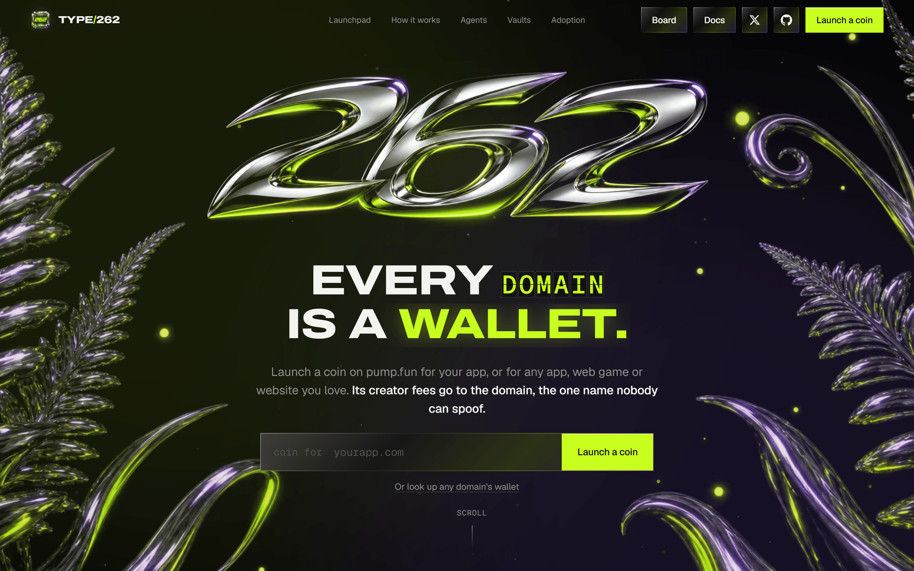</a></td>
</tr>
<tr>
<td width="50%" valign="top"><a href="https://type262.com/app.html#publish">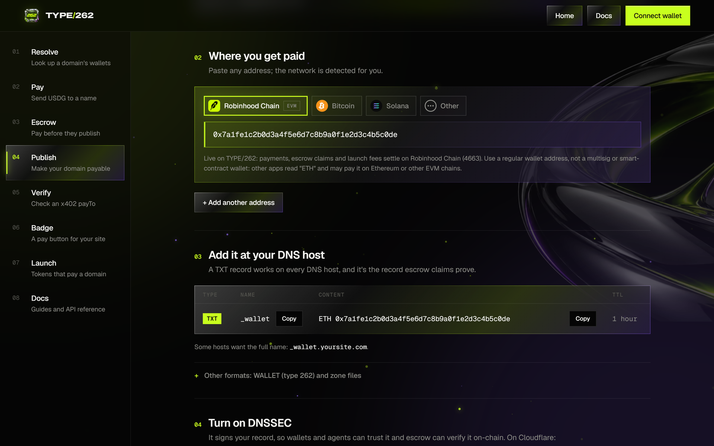</a><p align="center"><sub><b>Publish.</b> One record makes your domain payable on Solana.</sub></p></td>
<td width="50%" valign="top"><a href="https://type262.com/app.html#launch/new">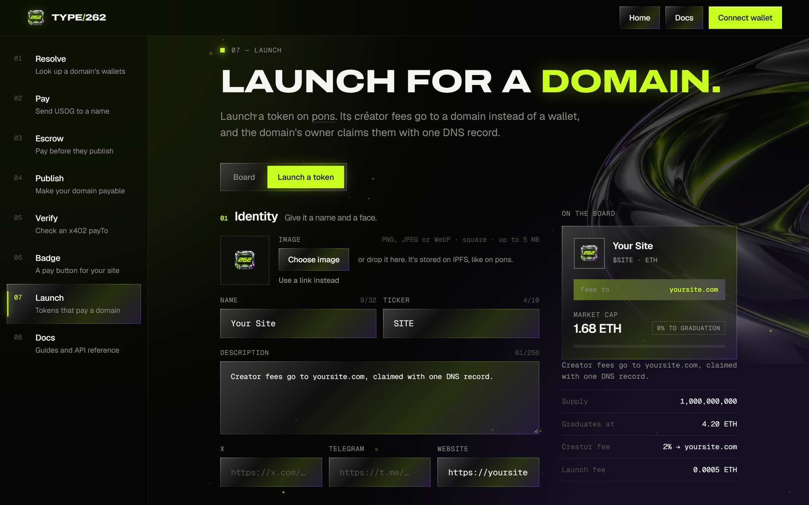</a><p align="center"><sub><b>Launch.</b> A pump.fun coin whose creator fees go to a domain.</sub></p></td>
</tr>
<tr>
<td width="50%" valign="top"><a href="https://type262.com/app.html#escrow">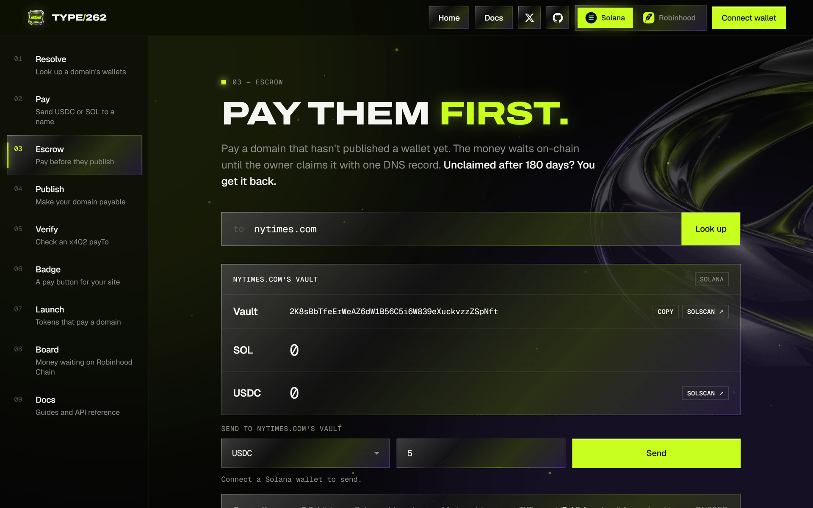</a><p align="center"><sub><b>Vaults.</b> Pay any website on Solana before it publishes.</sub></p></td>
<td width="50%" valign="top"><a href="https://type262.com/board">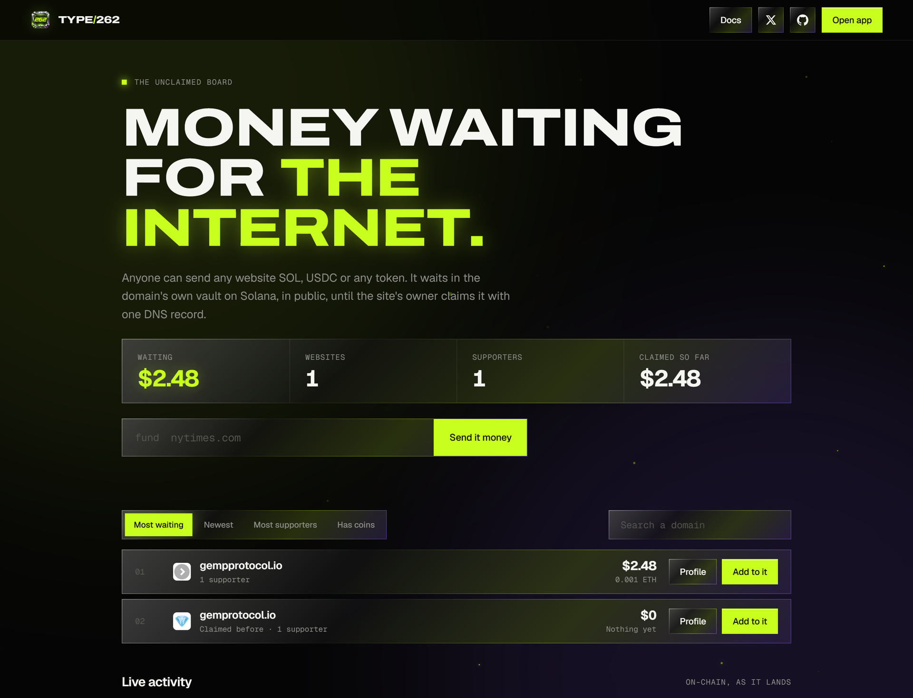</a><p align="center"><sub><b>The Unclaimed Board.</b> Money waiting for the internet.</sub></p></td>
</tr>
</table>

## How it works

<p align="center">
  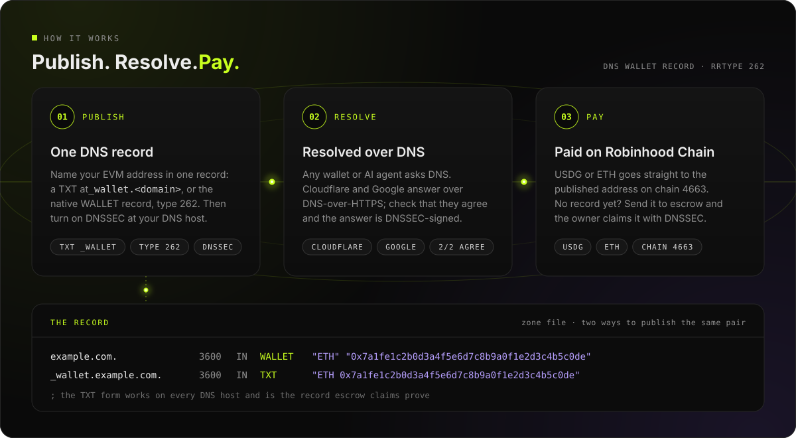
</p>

- **Resolution** queries two independent DNS-over-HTTPS resolvers and compares their answers. A record counts as verified only when every resolver answered, they all agree, and every one of them DNSSEC-authenticated it; each resolver's status is reported. It reads the `WALLET` record (type 262) and the `_wallet` TXT fallback in the same round trip, and counts only answers owned by the name itself, never a CNAME target's.
- **Payments** go straight from the payer's wallet to the address the domain publishes: SOL or USDC on Solana, USDG or ETH on Robinhood Chain. There is no TYPE/262 server in the payment path.
- **Claims** pay only the wallet a domain's DNSSEC-signed record names. On Solana, the worker pays a vault out once Cloudflare and Google agree on that record and both validated it. On Robinhood Chain, ENS's oracle checks the DNSSEC signatures on-chain, from the root keys down, with no server involved.
- **The site** is plain static files, so it can be hosted anywhere. One small Node service, the worker, runs Solana vault claims, collects and refunds, and pins launch images and coin metadata to IPFS. The board and the domain profiles read Solana and Robinhood Chain directly in your browser.

<p align="center">
  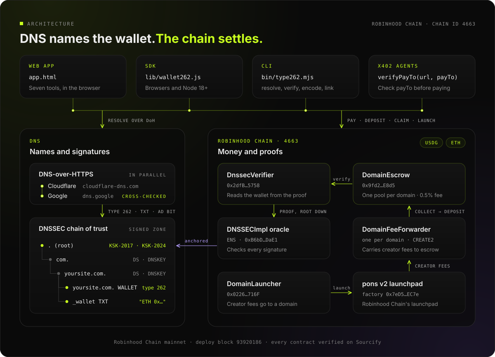
</p>

## Quickstart

### Make your domain payable

Add the record at your DNS host and turn on DNSSEC. The app's [Publish](https://type262.com/app.html#publish) tab writes these lines for your address and shows the exact Name and Value to paste at your DNS host.

```text
_wallet.yoursite.com.  3600 IN TXT     "SOL 9WzDXwBbmkg8ZTbNMqUxvQRAyrZzDsGYdLVL9zYtAWWM"
yoursite.com.          3600 IN WALLET  "SOL" "9WzDXwBbmkg8ZTbNMqUxvQRAyrZzDsGYdLVL9zYtAWWM"
yoursite.com.          3600 IN TYPE262 \# 49 03534F4C2C39577A44587742626D6B67385A54624E4D7155787651524179725A7A44734759644C564C397A59744157574D
```

| Line | Use it when |
|---|---|
| `_wallet TXT` | Your DNS host only offers a web dashboard. Works everywhere. |
| `WALLET "SOL" "…"` | Your DNS software knows type 262 by name. |
| `TYPE262 \# …` | Your DNS software speaks RFC 3597 generic records (BIND, Knot, NSD, PowerDNS). Works today. |

One Solana address (`SOL`) receives SOL, USDC, vault claims and launch fees on Solana. Add an `ETH` line for Robinhood Chain, or `BTC` for Bitcoin; one `_wallet` record set can carry them all.

### Resolve and pay from code

```bash
curl -O https://type262.com/lib/wallet262.js
```

```js
import { resolveWallets, addressKind, paymentUri } from './wallet262.js'

const r = await resolveWallets('yoursite.com')
// { records: [{ code: 'SOL', address: '9WzD…AWWM', source: 'TXT', dnssec: true }], agree: true, verified: true, resolvers: […], … }

if (!r.verified) throw new Error('No DNSSEC-verified wallet, or the resolvers disagree')
const to = r.records.find(x => addressKind(x.address) === 'solana')?.address
if (!to) throw new Error('yoursite.com publishes no Solana wallet')

// A Solana Pay link any Solana wallet opens: 25 USDC to the domain's wallet
const USDC = 'EPjFWdd5AufqSSqeM2qN1xzybapC8G4wEGGkZwyTDt1v'
console.log(paymentUri(to, { amount: '25', splToken: USDC }))
// solana:9WzDXwBbmkg8ZTbNMqUxvQRAyrZzDsGYdLVL9zYtAWWM?amount=25&spl-token=EPjFWdd5AufqSSqeM2qN1xzybapC8G4wEGGkZwyTDt1v
```

`verified` is true when records were found, every resolver answered, they all agree and every record is DNSSEC-authenticated on every resolver; `r.resolvers` shows each resolver's status. The SDK accepts domains, URLs and email addresses (`bob@shop.com` resolves `shop.com`), and also runs in Node 18+. To send from a browser wallet instead, the [docs](https://type262.com/docs.html#payments) show the app's Solana client and the Robinhood Chain transfer.

### Verify an x402 payTo

```js
import { payTosFromX402, verifyPayTo } from './wallet262.js'

const res = await fetch('https://api.yoursite.com/report')
if (res.status === 402) {
  for (const payTo of payTosFromX402(await res.json())) {
    const check = await verifyPayTo('https://api.yoursite.com/report', payTo)
    if (!check.strong) throw new Error(`Refusing to pay ${payTo}: ${check.reason}`)
  }
  // every payTo is published by yoursite.com, and every resolver returned it DNSSEC-signed: pay
}
```

### From the terminal

```bash
curl --create-dirs -o type262/bin/type262.mjs https://type262.com/bin/type262.mjs \
     -o type262/lib/wallet262.js https://type262.com/lib/wallet262.js

node type262/bin/type262.mjs resolve yoursite.com                  # wallets a domain publishes
node type262/bin/type262.mjs verify https://api.yoursite.com 9WzD…  # does this payTo belong to the domain?
node type262/bin/type262.mjs encode yoursite.com SOL 9WzD…          # zone lines to publish
node type262/bin/type262.mjs link yoursite.com 5 USDC               # Solana Pay link (SOL, USDC; USDG, ETH on Robinhood Chain)
```

## On Solana

Solana is TYPE/262's main network, and nothing of TYPE/262's own has to run on-chain there. Payments to a published address go straight from the payer's wallet to the domain's wallet. Everything that waits for a domain waits in the domain's **vault**, and a small service, the **worker**, pays vaults out to their owners.

```text
pay      payer's wallet ──transfer──▶ the SOL address yoursite.com publishes
vault    anyone ──SOL, USDC or any SPL token──▶ vault(yoursite.com)
launch   pump.fun create_v2, creator = vault(yoursite.com) ──trades──▶ creator fees ──collect──▶ vault
claim    anyone ──POST /solana/claim──▶ worker checks DNSSEC ──▶ the published wallet, minus 0.5%
refund   anyone ──POST /solana/refund──▶ after 180 days, if no claim since ──▶ the original sender
```

### Domain vaults

Every domain has its own Solana address, derived for that domain by the worker from a master secret: `HMAC-SHA256(master secret, "type262:vault:" + domain)` is the seed of the vault's Ed25519 key. The address never changes, and it is public: `GET /solana/vault?domain=yoursite.com` returns it with its USDC token account.

- **Anyone can pay it** with a plain transfer: SOL to the vault, USDC or any other SPL token to the vault's associated token account, created by the sender if it doesn't exist yet.
- **One vault per canonical name.** `https://YourSite.com/pay` and `bob@yoursite.com` reach the vault of `yoursite.com`; a subdomain has its own.
- **Everything is on-chain.** Balances, deposits, payouts and refunds can be read on any explorer, and the worker keeps no database.

<p align="center">
  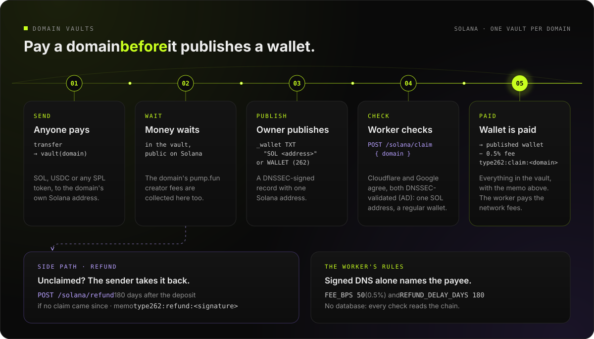
</p>

### Claims

Anyone can ask the worker to claim a domain's vault, and the money only ever goes to the wallet the domain publishes.

| A claim checks | |
|---|---|
| The record | `_wallet.<domain> TXT "SOL <address>"`, or a `WALLET` record at the domain, publishes exactly one Solana address |
| Both resolvers | Cloudflare and Google DNS-over-HTTPS both answer, publish the same address, and both report it DNSSEC-authenticated (AD) |
| A regular wallet | The address is a System Program account with no data, or doesn't exist yet: never a token account, a mint or a program |

Then the worker collects the creator fees of the domain's pump.fun coins into the vault, and pays out everything the vault holds, SOL and every SPL token, minus 0.5% of each to the fee wallet. Each payout carries the memo `type262:claim:<domain>`, and the worker's gas wallet pays the network fees and the owner's token-account rent.

### Refunds

A sender can get a deposit back 180 days after it was made, if the domain hasn't claimed since and the deposit wasn't refunded already. `POST /solana/refund` takes the domain and the deposit's transaction signature; the worker checks the deposit and the vault's history on-chain and pays the original sender, with the memo `type262:refund:<deposit signature>`.

### Launch a coin on pump.fun

```text
launch   your wallet ──create_v2──▶ pump.fun          creator = vault(yoursite.com)
trades   buys and sells ──▶ creator fee, kept by pump.fun for the vault
collect  anyone ──sweep + collect (pump.fun, PumpSwap)──▶ vault(yoursite.com)
claim    anyone ──POST /solana/claim──▶ the wallet yoursite.com publishes
```

- **The creator is the domain's vault.** pump.fun takes the creator as plain data, so the vault never signs the launch, and every creator fee of the coin accrues to it.
- **Fees can only flow to the vault.** pump.fun's sweeps and collects are permissionless and their destinations are fixed by pump.fun, so whoever sends them, the fees land in the domain's vault, on the bonding curve and on PumpSwap after graduation.
- **One creator per domain**, so one collect pays out the fees of all of a domain's coins. Every claim collects first.
- **An opening buy** can ride in the launch transaction, so the launcher buys before anyone else can trade.

### Worker API

The worker is the `type262-upload` service at `https://type262-upload.onrender.com`.

| Endpoint | Body | Returns |
|---|---|---|
| `GET /solana/vault?domain=<d>` | | `{ domain, vault, usdcAccount }` |
| `POST /solana/claim` | `{ domain }` | `{ domain, wallet, vault, collected: [{ mint, lamports, source }], payouts: [{ mint, amount, fee, decimals, program, signature }], signatures, skipped }` |
| `POST /solana/collect` | `{ domain }` | `{ domain, vault, collected, signatures }`: pump.fun fees into the vault only |
| `POST /solana/refund` | `{ domain, signature }` | `{ domain, refunded: { mint, amount, decimals, to }, signature }` |
| `GET /solana/status` | | `{ ready, gasWallet, gasLamports, feeWallet, feeBps, refundDelayDays }` |

Amounts are decimal strings in base units, and `mint` is `"SOL"` for SOL. Errors are JSON, `{ error, reason }`, with a plain-language reason. The `POST` endpoints accept the site's origins only and are rate-limited per IP. The [Worker API](https://type262.com/docs.html#solana-worker) docs list every field.

### Trust model

On Solana, vaults are custodial: the TYPE/262 worker holds the master secret every vault key derives from, and pays a vault out only after checking the domain's DNSSEC-signed record through two independent resolvers. Every vault and every payout is public on-chain. On Robinhood Chain, the contracts verify DNSSEC on-chain and no server takes part in a claim.

The repository also holds `type262`, a Solana program that verifies DNSSEC on-chain from the root keys and holds domain funds in program accounts, so Solana claims would need no server either. It is built and tested in [`solana/`](solana/README.md), with 86 LiteSVM tests and an end-to-end run on a local validator, and not deployed; see [On-chain program](https://type262.com/docs.html#solana-program).

## Robinhood Chain

Robinhood Chain (chain id 4663) stays fully supported: pay a domain in USDG or ETH, claim with a DNSSEC proof checked on-chain, and launch pons v2 tokens whose creator fees go to a domain.

- **Payments** settle in USDG, a 6-decimal stablecoin, or ETH. The browser wallet sends straight to the address the domain publishes.
- **Claims** go through `DomainEscrow`, and `DnssecVerifier` checks the DNSSEC signature chain on-chain through ENS's `DNSSECImpl` oracle, anchored to the IANA root keys (KSK-2017 and KSK-2024), whose ownership was renounced at deploy. A real proof for `cloudflare.com` verifies for about 628k gas. Records accepted: `_wallet.<domain> TXT "ETH 0x…"` or `<domain> WALLET "ETH" "0x…"`.
- **The contracts are not upgradeable**, and the fee, fee recipient and refund delay are fixed at deploy.

<details>
<summary><b>Robinhood Chain contracts: how a DNSSEC proof is checked on-chain</b></summary>
<br>

<p align="center">
  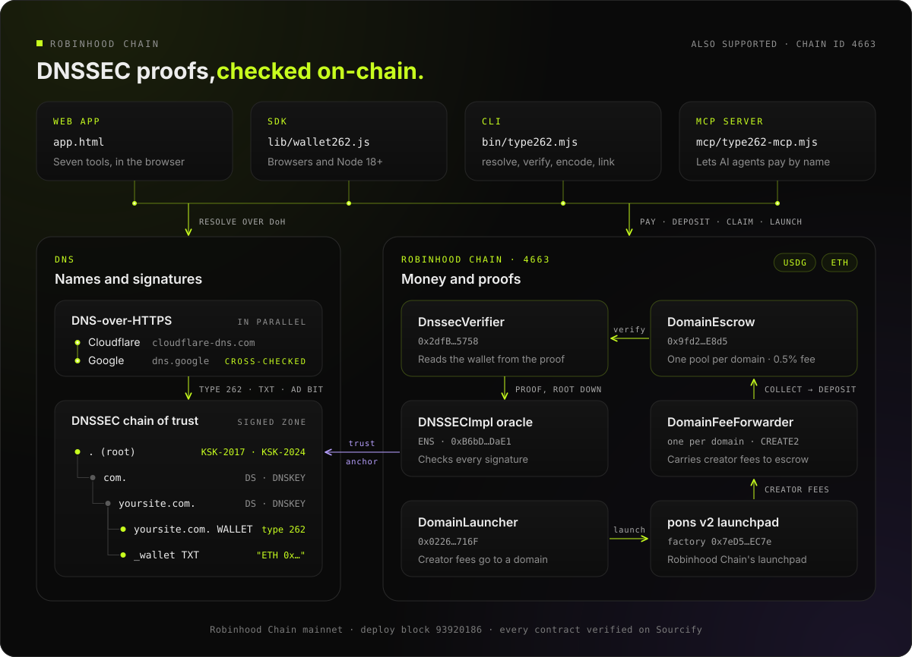
</p>

</details>

<details>
<summary><b>Claimable escrow on Robinhood Chain</b></summary>
<br>

<p align="center">
  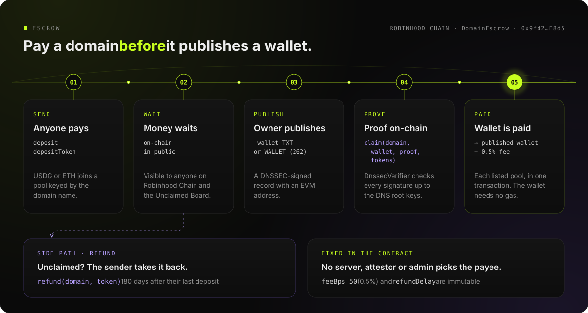
</p>

Money sent to a domain waits in `DomainEscrow` in a pool keyed by the domain name. When the owner publishes a DNSSEC-signed record with an EVM address, anyone can submit the proof and the contract pays that address instantly. Only EVM coin codes (ETH, USDG, HOOD…) with exactly `0x` + 40 hex count.

</details>

<details>
<summary><b>Website coins on pons: how creator fees reach a domain</b></summary>
<br>

```text
launch ──▶ DomainLauncher ──▶ pons factory (creatorFeeRecipient = the domain's forwarder)
trades ──▶ pons fee escrow ──collect(domain)──▶ DomainFeeForwarder ──▶ DomainEscrow ──claim──▶ domain owner
```

- Each domain has one `DomainFeeForwarder` at a CREATE2 address known before it exists, so fees accrue from the first trade.
- The forwarder has no owner and never changes its fee recipient.
- `collect` is permissionless. It sweeps the bonding curves, pulls ETH and USDG from pons and deposits them into `DomainEscrow` under the domain. After graduation, `collectPools` sweeps the token's Uniswap v4 pools.
- Launches always have buyback off, and any part of an opening buy the curve can't take is refunded in the same transaction.

</details>

## AI agents

The MCP server pays on Robinhood Chain, in USDG or ETH. A domain whose DNSSEC-signed EVM address every resolver agrees on is paid directly. A domain that publishes no EVM address (only a Solana one, for example), or only an unsigned one, is paid into `DomainEscrow` on Robinhood Chain, and its owner claims it with an EVM record.

### Give your agent a wallet

```bash
curl -fsSL https://type262.com/mcp/type262-mcp.mjs -o ~/type262-mcp.mjs
```

Add it to Claude Desktop (`claude_desktop_config.json`), Cursor or any MCP client:

```json
{
  "mcpServers": {
    "type262": {
      "command": "node",
      "args": ["/Users/you/type262-mcp.mjs"],
      "env": {
        "TYPE262_PRIVATE_KEY": "0x…",
        "TYPE262_MAX_USDG": "25",
        "TYPE262_DAILY_USDG": "100"
      }
    }
  }
}
```

Or with Claude Code:

```bash
claude mcp add type262 -e TYPE262_PRIVATE_KEY=0x… -- node ~/type262-mcp.mjs
```

Then ask your agent to *"send yoursite.com 5 USDG"*. Without a key, resolving, verifying, escrow balances and every dry run still work, and `wallet_status` explains how to add one.

### How pay_domain decides

<p align="center">
  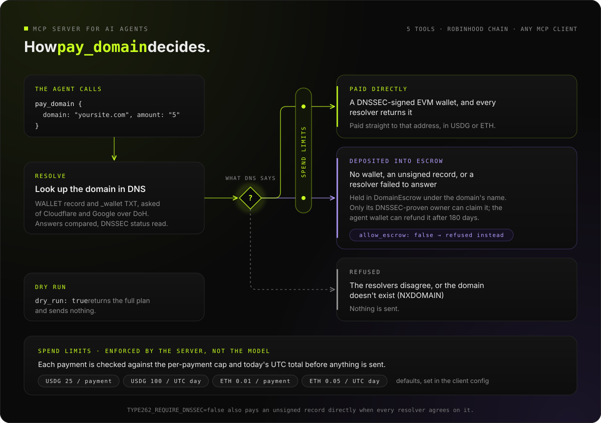
</p>

| Tool | What it does |
|---|---|
| `resolve_domain` | The wallets a domain publishes, whether the resolvers agree and DNSSEC signed them, what `pay_domain` would do, and what already waits in `DomainEscrow` on Robinhood Chain |
| `verify_payto` | Checks one address, or every `payTo` in a 402 body, against the domain you are talking to: `safe`, `unsigned` or `no_match` |
| `pay_domain` | Pays a domain by name in USDG or ETH. `dry_run: true` returns the full plan and sends nothing; the same asset and amount to the same recipient within 10 minutes needs `repeat: true`, even under another name or URL |
| `escrow_status` | USDG and ETH waiting in `DomainEscrow` for a domain |
| `wallet_status` | The agent wallet's address, balances, limits and what it spent today |

Spend limits live in the server's environment, not in the prompt: by default 25 USDG per payment and 100 per UTC day, 0.01 ETH per payment and 0.05 per day. Payments run one at a time in each server process, and a lock file shared by every process keeps the daily limit across them. A payment the client cancels before it starts is never sent. The key is read once and never logged, and every successful result carries a one-line summary the agent can repeat to you (refusals carry a one-line error). Full reference: [docs › MCP server](https://type262.com/docs.html#mcp).

## Deployments

### Solana

Solana mainnet. Vaults are ordinary addresses and launches use pump.fun's own programs, so there is no TYPE/262 program to deploy.

| | |
|---|---|
| Worker | `https://type262-upload.onrender.com`, see [Worker API](https://type262.com/docs.html#solana-worker) |
| Gas and fee wallet | [`3sde4YJpX2oYMSWaozHareWrXn6MASLxhQgfuCKJNPoK`](https://solscan.io/account/3sde4YJpX2oYMSWaozHareWrXn6MASLxhQgfuCKJNPoK) |
| Claim fee, refund delay | 0.5%, 180 days after each deposit |
| USDC | `EPjFWdd5AufqSSqeM2qN1xzybapC8G4wEGGkZwyTDt1v` (6 decimals) |

`GET /solana/status` returns these settings live, with the gas wallet's balance.

### Robinhood Chain

Robinhood Chain mainnet. Every contract is verified on [Sourcify](https://sourcify.dev) with an exact match.

| Contract | Address |
|---|---|
| `DomainEscrow` | [`0x9fd2f1Dc0B42e8a2E86e3Cf231a293654691E8d5`](https://robinhoodchain.blockscout.com/address/0x9fd2f1Dc0B42e8a2E86e3Cf231a293654691E8d5) · [source](https://repo.sourcify.dev/4663/0x9fd2f1Dc0B42e8a2E86e3Cf231a293654691E8d5) |
| `DomainLauncher` | [`0x022657aC8bdD969Fa5149E7A86FBBda2AfAf716F`](https://robinhoodchain.blockscout.com/address/0x022657aC8bdD969Fa5149E7A86FBBda2AfAf716F) · [source](https://repo.sourcify.dev/4663/0x022657aC8bdD969Fa5149E7A86FBBda2AfAf716F) |
| `DnssecVerifier` | [`0x2dfB277A25ea096b182F86665D130B9b53B15758`](https://robinhoodchain.blockscout.com/address/0x2dfB277A25ea096b182F86665D130B9b53B15758) · [source](https://repo.sourcify.dev/4663/0x2dfB277A25ea096b182F86665D130B9b53B15758) |
| `DNSSECImpl` (ENS oracle, no owner) | [`0xB6bDbff51a51Fb8743dAaa115317d9a72fEbDaE1`](https://robinhoodchain.blockscout.com/address/0xB6bDbff51a51Fb8743dAaa115317d9a72fEbDaE1) · [source](https://repo.sourcify.dev/4663/0xB6bDbff51a51Fb8743dAaa115317d9a72fEbDaE1) |

The full record, including the signature algorithms and digests, is in [`deployments/robinhood-4663.json`](deployments/robinhood-4663.json).

| Network | |
|---|---|
| Chain ID | `4663` (`0x1237`) |
| RPC | `https://rpc.mainnet.chain.robinhood.com` |
| Explorer | [robinhoodchain.blockscout.com](https://robinhoodchain.blockscout.com) |
| USDG | [`0x5fc5360D0400a0Fd4f2af552ADD042D716F1d168`](https://robinhoodchain.blockscout.com/token/0x5fc5360D0400a0Fd4f2af552ADD042D716F1d168) (6 decimals) |

## Repository layout

```text
.
├── index.html · app.html · docs.html   the site: landing, app and docs (static, no build step)
├── board.html · domain.html            The Unclaimed Board and domain profiles
├── assets/                             site scripts, styles and art; solana*.js are the Solana clients
├── lib/wallet262.js                    zero-dependency SDK for browsers and Node 18+
├── bin/type262.mjs                     CLI
├── mcp/                                MCP server for AI agents: source and single-file bundle
├── upload/                             the worker (server.mjs, worker.mjs, vault.mjs): Solana vaults, claims,
│                                       collects and refunds; image and coin-metadata uploads; RPC fallbacks
├── solana/                             Anchor workspace: the type262 program (built and tested, not deployed),
│   │                                   LiteSVM tests, specs, benchmarks, pump.fun encoders
│   ├── programs/type262/                 escrow, DNSSEC verifier, pump.fun launcher
│   ├── tests-rs/                         LiteSVM suites
│   ├── docs/                             DNSSEC.md and PUMP.md, the specifications
│   └── scripts/                          fixtures, pump.fun encoders and simulations, the local end-to-end runs
├── contracts/                          Foundry: escrow, verifier, launcher, forwarder on Robinhood Chain
├── deployments/                        addresses and transactions of the Robinhood Chain deployment
├── scripts/                            site build and post-deploy scripts
└── test/                               SDK, ABI, board, upload, MCP and Solana client tests
```

## Development

You need Node 18+ (20+ for the Solana proof tests), Python 3 for `npm run dev`, WSL on Windows for the local Solana validator, the Rust, Solana and Anchor toolchain in [`solana/README.md`](solana/README.md) for the on-chain program, and [Foundry](https://getfoundry.sh) for the contracts.

```bash
git clone --recurse-submodules https://github.com/Type262/262.git
cd 262
npm ci

npm run dev                         # serves the site at http://127.0.0.1:5262
npm test                            # SDK, ABI, board (both chains), worker and MCP tests
npm run test:mcp:fork               # MCP payments end to end on a local Robinhood Chain fork
npm run mcp:build                   # rebuild mcp/type262-mcp.mjs
node test/solana.test.mjs           # Solana client (12 tests)
node test/solana-vault.test.mjs     # the vault client: pump.fun instructions, launches, the worker API (offline)
sh scripts/build.sh                 # the static build Render serves, in dist/
node solana/scripts/ui-e2e.mjs      # the app's Solana screens in headless Chromium, on a local validator

# the on-chain program (built and tested, not deployed)
node test/solana-proof.test.mjs     # DNSSEC proofs for the program (20)
node test/solana-type262.test.mjs   # the program's instructions, byte for byte (24)
cd solana && anchor build           # the program, its IDL and types
node scripts/fetch-fixtures.mjs     # once: pump.fun programs and accounts for the tests (read-only)
cd tests-rs && cargo test           # 78 LiteSVM tests: escrow, DNSSEC with real proofs, pump.fun launches
cd ../.. && node solana/scripts/e2e-local.mjs   # the program on a local validator: 43 transactions, 84 checks

cd contracts && forge test          # unit and fuzz tests
mkdir -p test/fixtures && node script/make-proof.mjs TXT cloudflare.com > test/fixtures/proof.hex
FORK_RPC=https://rpc.mainnet.chain.robinhood.com forge test --evm-version osaka   # plus mainnet-fork simulations
```

The program's P-256 and Ed25519 precompile tests run with `cargo test --features precompiles`, in WSL on Windows, 86 tests in all; [`solana/README.md`](solana/README.md) has the commands. Every Solana test runs on LiteSVM or a local validator with keys and secrets generated for the run. The fork simulations run against the real USDG and pons v2 contracts and need `--evm-version osaka`, and the DNSSEC test needs the fresh proof built on the line above. Deploying your own contracts on Robinhood Chain is one command; see [DEPLOY.md](DEPLOY.md).

## Security

TYPE/262 moves real money, so every claim pays only the wallet a domain's DNSSEC-signed record names:

- On Solana, vaults are custodial. The worker holds the master secret every vault key derives from, and pays a vault out only when Cloudflare and Google both return the domain's record, agree on it and report it DNSSEC-authenticated, and only to a regular wallet. Every vault, deposit, payout and refund is public on-chain, each payout marked with the domain it settles.
- On Robinhood Chain, claims are paid only against a DNSSEC proof verified on-chain through ENS's `DNSSECImpl`, with no server in the path, and the contracts are verified on Sourcify with exact matches. The escrow admin can pause new deposits and nothing else.
- The contracts are covered by Foundry tests, including fuzzing and Robinhood Chain fork simulations. The app's Solana screens run end to end on a local validator, and the on-chain Solana program by 86 LiteSVM tests with six real DNSSEC chains, tampered proofs and the mainnet pump.fun programs.

Found a vulnerability? Report it privately through [GitHub's private vulnerability reporting](https://github.com/Type262/262/security/advisories/new). See [SECURITY.md](SECURITY.md).

## Contributing

Issues and pull requests are welcome. Start with [CONTRIBUTING.md](CONTRIBUTING.md); the [docs](https://type262.com/docs.html) cover every module in depth.

## License

[MIT](LICENSE)

<br>

<div align="center">
  <a href="https://type262.com"></a>
  <br>
  <sub><a href="https://type262.com">type262.com</a> · <a href="https://x.com/type_262">@type_262 on X</a></sub>
  <br>
  <sub>Payments settle on Solana, with Robinhood Chain (4663) also supported. Not affiliated with IANA, ICANN, Solana, pump.fun, Robinhood or the x402 project.</sub>
</div>
